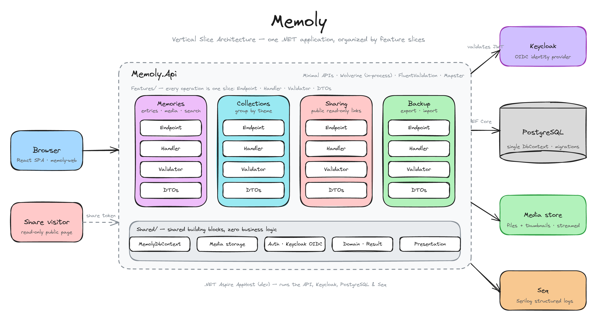

# Memoly

Photos, videos, voice recordings, and their stories — kept together.

## Overview

Photos end up in the camera roll. Videos stay in chats. Notes get written and forgotten. Memoly keeps every kind of memory in one app, so each one is easy to find again years later.

Every entry holds its media together with the details that matter: how you felt, where it happened, and why it was worth keeping. Entries can be grouped into collections and found by search.

A memory can also be shared as a link — a small page that shows just that one, styled with your own colors and text. Send it around to show the moment off to anyone; revoke it anytime.

Memoly is for anyone who records life as it happens — journal keepers, families, travelers, couples — and above all for those who want to keep someone's voice safe.

The goal is not to invent a new way of saving memories. It is to do it well: an app that is beautiful to open, easy to browse, and simple to come back to. Every kind of entry — voice above all — lives side by side, and everything can be exported and imported whenever needed.

## Features

- **Four kinds of entries** — photos, videos, voice recordings, and writing
- **Context** — each entry carries a mood, a place, and its story
- **Collections** — group entries by theme
- **Search** — find an old entry in seconds
- **Time Capsules** — hide an entry until a date you choose
- **Share links** — turn a memory into a link to show anyone, with its own look: colors, text, and more
- **Backup & transfer** — export and import everything, any time

## Architecture



Modular monolith backend (each bounded context an isolated module communicating via integration events) + React SPA client.

## Tech Stack

### Backend

| Component      | Technology                                           |
| -------------- | ---------------------------------------------------- |
| Runtime        | .NET 10, C# 14                                       |
| Orchestration  | .NET Aspire                                          |
| Reverse Proxy  | Traefik                                              |
| API            | ASP.NET Core Minimal APIs                            |
| ORM            | EF Core                                              |
| API Docs       | Scalar                                               |
| Logging        | Serilog + Seq                                        |
| Resilience     | Polly v8                                             |
| Messaging & CQRS | Wolverine (RabbitMQ, transactional outbox)         |
| Validation     | FluentValidation                                     |
| Mapping        | Mapster                                              |
| Authentication | OpenIddict                                           |
| Testing        | xUnit v3, Fluent Assertions, Moq, Testcontainers    |
| Code Quality   | SonarQube                                            |
| Architecture   | Modular Monolith                                     |

### Frontend

| Component     | Technology          |
| ------------- | ------------------- |
| Framework     | React + Vite        |
| State         | Zustand             |
| UI Components | shadcn/ui           |
| Icons         | Lucide Icons        |
| Styling       | Tailwind CSS        |

## Roadmap

- **Phase 1 (current)** — web: React SPA + .NET backend API.
- **Phase 2 (future)** — native iOS client consuming the same API.

## Getting Started

> The project has not been scaffolded yet.

```bash
# Backend (via Aspire — starts API + all containers)
dotnet run --project src/Aspire/Memoly.AppHost

# Frontend
cd src/Frontend/memoly-web
npm install
npm run dev
```

## License

Personal project — not for distribution.
